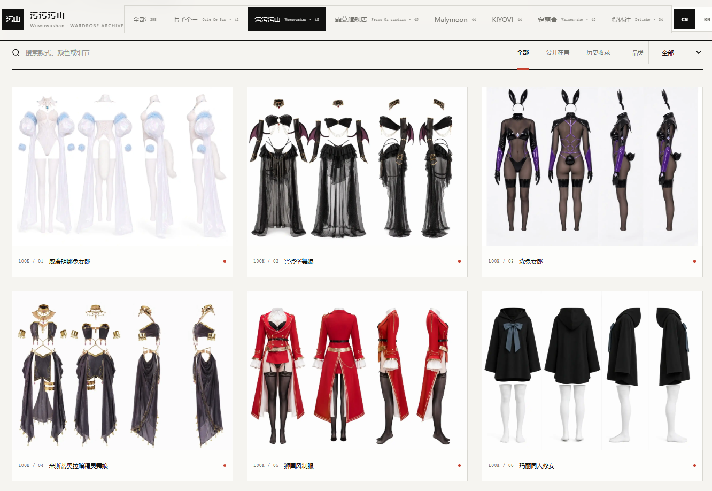
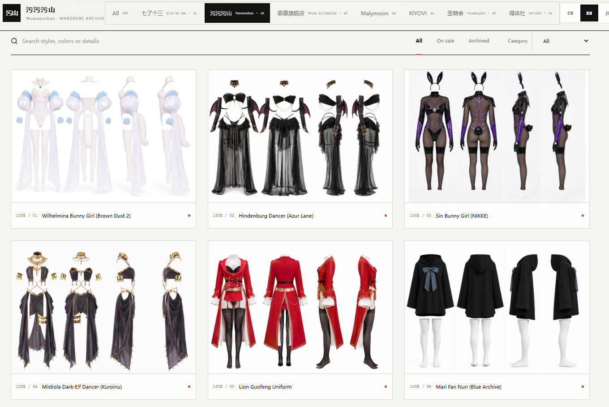
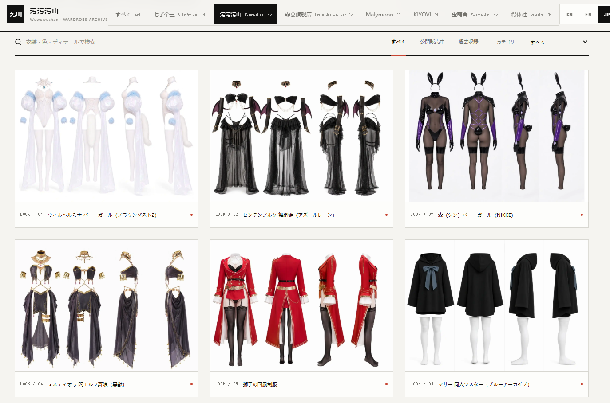

# 擦边衣橱 · Cosplay Lingerie · ギリギリ衣装棚

**中文** | [English](#english) | [日本語](#日本語)

---

## 中文

一个纯静态的「服装四视图档案站」：收录 7 家淘宝服装店共 298 款服装，每款以**前 / 后 / 左 / 右**四个等宽竖向面板呈现穿着形态，白底、无人物、无标注，可逐款浏览、检索、下载。

**线上地址：<https://cos-lingerie.pages.dev>**



### 特性

- 298 款商品 · 7 店归档（七了个三 / 污污污山 / 霏慕旗舰店 / Malymoon / KIYOVI / 歪萌舍 / 得体社）
- 三语界面：中文 / English / 日本語，一键切换，localStorage 记忆
- 每款四视图：2048×1472 WebP，前/后/左/右等宽面板
- 按店归档 + 状态筛选（在售 / 历史收录）+ 品类筛选 + 关键词搜索（三语均可搜）
- 详情弹窗：整图 / 单视角裁剪 / 翻页 / 下载 / 复制深链
- 静态部署友好：构建产物为纯 HTML/JS/CSS + WebP，无后端

### 技术栈

React 19 · TypeScript · Vite 7 · Tailwind CSS · shadcn/ui 组件 · Cloudflare Pages

### 本地开发

```bash
npm install
npm run build   # tsc -b && vite build，postbuild 注入 JSON-LD
```

`npm run dev` 亦可，但本站约定以构建产物为准验证。

### 目录结构

```
src/
  pages/Home.tsx        # 整站单页（宫格 + 弹窗 + 语言切换）
  data/
    products.ts         # 七了个三 + 店铺元数据
    *-products.ts       # 其余 6 店商品数组
    i18n.ts             # 生成产物：UI 文案 / 店铺 / 品类 / 配色 / 294→298 款翻译
  App.css               # 全部样式
public/views/           # 298 张四视图 WebP（每款一张）
scripts/
  gen-i18n.py           # 由 i18n-data/*.py 生成 src/data/i18n.ts（断言全覆盖）
  i18n-data/            # 英/日翻译表（商品名、详情、46 种详情头）
  inject-geo.mjs        # postbuild：向 dist/index.html 注入 JSON-LD
```

### 数据与图片说明

- 商品信息（名称、价格、销量、来源链接）整理自淘宝公开商品页与公开历史收录，口径原样保留，不代表实时数据。
- 四视图图片为 AI 重建的档案图：无人物、白底、未展示角度为推定。仅作档案参考，非商品实拍。
- 涉及的游戏 / 动漫角色版权归属各权利方，本站仅为服装形态研究档案。

### License

MIT（见 [LICENSE](LICENSE)）。数据与图片如需转载请注明出处。

---

## English

A purely static **garment four-view archive**: 298 pieces from 7 Taobao costume shops, each rendered as four equal-width vertical panels — **front / back / left / right** — on a plain white background. No people, no annotations. Browse, search and download per piece.

**Live: <https://cos-lingerie.pages.dev>**



### Features

- 298 pieces across 7 shops (Qilesan / Wuwuwushan / Feimu / Malymoon / KIYOVI / Waimengshe / Detishe)
- Trilingual UI: 中文 / English / 日本語 with one-click switching (localStorage-persisted)
- Four views per piece: 2048×1472 WebP, equal-width front/back/left/right panels
- Per-shop archives, status filter (on sale / archived), category filter, keyword search in all three languages
- Detail modal: full panel, single-view crops, prev/next, download, copy deep link
- Backend-free static output: plain HTML/JS/CSS + WebP, deployable anywhere

### Stack

React 19 · TypeScript · Vite 7 · Tailwind CSS · shadcn/ui · Cloudflare Pages

### Development

```bash
npm install
npm run build   # tsc -b && vite build; postbuild injects JSON-LD
```

### Data & image notes

- Product info (names, prices, sales figures, source links) was compiled from public Taobao listing pages and public archived records; values are kept as-is and are not real-time.
- The four-view images are AI-rebuilt archive plates: no wearer, white background, unshown angles inferred. Reference only — not actual product photos.
- Game/anime characters referenced belong to their respective rights holders; this site is a garment-study archive only.

### License

MIT (see [LICENSE](LICENSE)).

---

## 日本語

淘宝のコスプレ衣装店 7 店舗・全 298 点を、**前 / 後 / 左 / 右**の 4 等分パネルで記録した純粋な静的アーカイブサイトです。白背景・人物なし・注釈なし。各衣装の閲覧・検索・ダウンロードに対応。

**公開サイト：<https://cos-lingerie.pages.dev>**



### 特徴

- 7 店舗・298 点（七了个三 / 污污污山 / 霏慕 / Malymoon / KIYOVI / 歪萌舍 / 得体社）
- 3 言語 UI：中文 / English / 日本語、ワンクリック切替（localStorage 記憶）
- 各衣装 4 方向ビュー：2048×1472 WebP、前後左右の等分パネル
- 店舗別アーカイブ、販売状態フィルタ、カテゴリフィルタ、3 言語対応キーワード検索
- 詳細モーダル：全体図 / 単一方向クロップ / 前後移動 / ダウンロード / 深いリンクのコピー
- バックエンド不要の静的出力：HTML/JS/CSS + WebP のみ

### 技術構成

React 19 · TypeScript · Vite 7 · Tailwind CSS · shadcn/ui · Cloudflare Pages

### 開発

```bash
npm install
npm run build   # tsc -b && vite build（postbuild で JSON-LD を注入）
```

### データと画像について

- 商品情報（名称・価格・販売数・出典リンク）は淘宝網の公開商品ページおよび公開履歴収録に基づき、元の値をそのまま保持しています。リアルタイムの情報ではありません。
- 4 方向画像は AI による再構成アーカイブ図です。人物は含まれず、未掲載の角度は推定です。実物の商品写真ではありません。
- 登場するゲーム・アニメのキャラクター権利は各権利者に帰属します。本サイトは衣装の造形を記録する研究アーカイブです。

### ライセンス

MIT（[LICENSE](LICENSE) 参照）。
